# BrodaShop

A premium fashion e-commerce demo store built with modern web technologies.
Timeless silhouettes, contemporary essentials — and a heavily animated,
motion-first interface.

   

## Features

- **Motion-first design** — framer-motion page transitions, scroll reveals,
  parallax, marquee, magnetic buttons, custom cursor, and a cinematic
  preloader intro
- **Full shopping flow** — cart with quantities, wishlist, quick view, size
  guide modal, search overlay, and a simulated checkout
- **Rich catalog** — 22 products across Women / Men / Outerwear / Tops /
  Bottoms / Shoes / Accessories with color variants and filtering
- **Editorial pages** — Journal with full articles, full-screen parallax
  Lookbook, brand Story, Contact, and Size Guide
- **Polish details** — animated 404 page, toasts, scroll progress bar,
  back-to-top, hide-on-scroll navbar, reduced-motion support

## Pages

| Route | Page |
| --- | --- |
| `/` | Home |
| `/shop` | Shop (filters, sorting, URL-synced state) |
| `/products/:slug` | Product detail (gallery, zoom, lightbox) |
| `/story` | Brand story |
| `/journal` | Journal index |
| `/journal/:slug` | Journal article |
| `/lookbook` | AW26 parallax lookbook |
| `/wishlist` | Saved pieces |
| `/account` | Simulated sign-in / account |
| `/contact` | Contact form + FAQ |
| `/size-guide` | Size guide |
| `/checkout` | Demo checkout |
| `*` | Animated 404 |

## Screenshots

| Home | Shop | Product Detail |
|:---:|:---:|:---:|
| 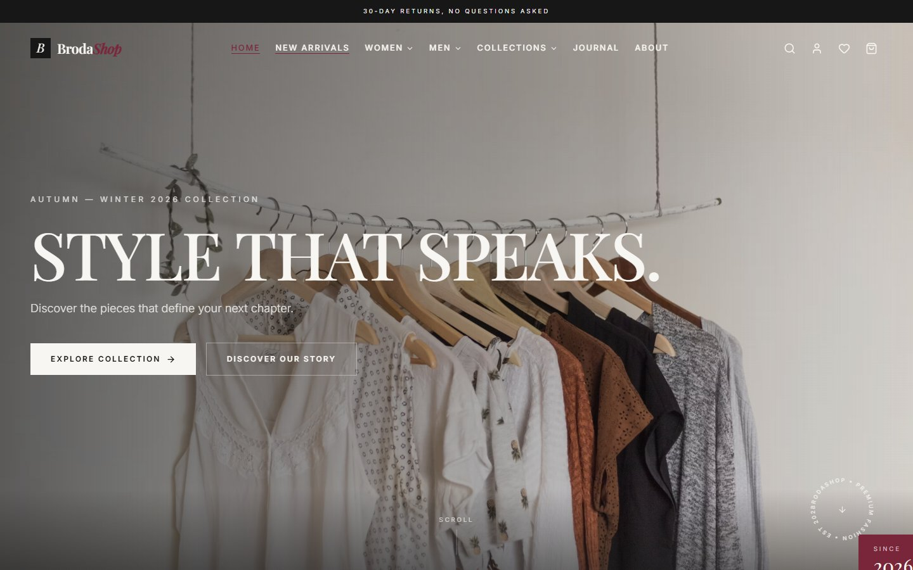 | 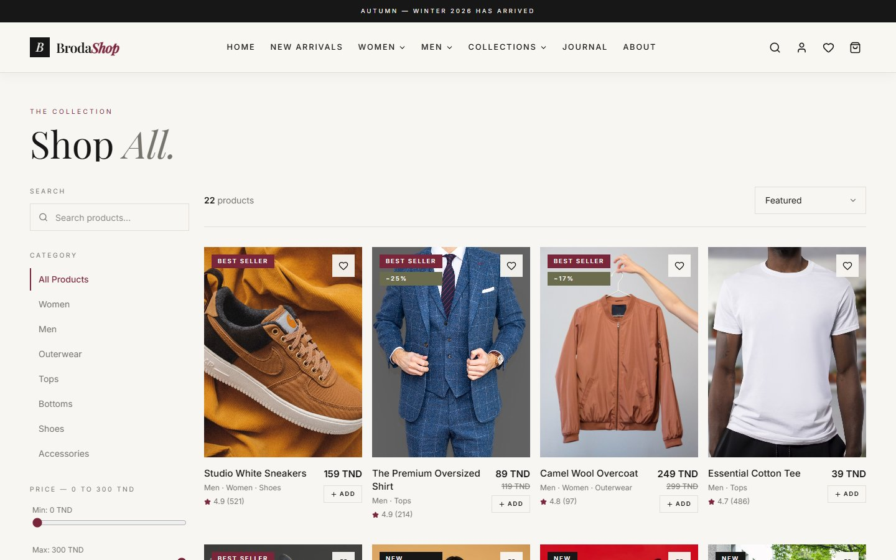 | 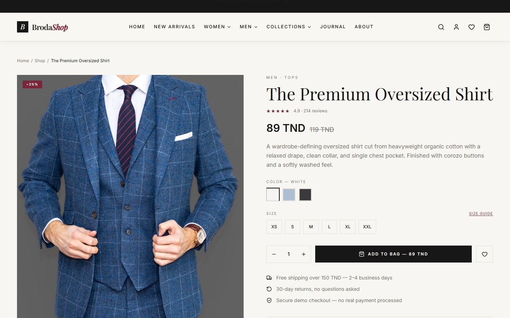 |

| Story | Journal | Journal Article |
|:---:|:---:|:---:|
| 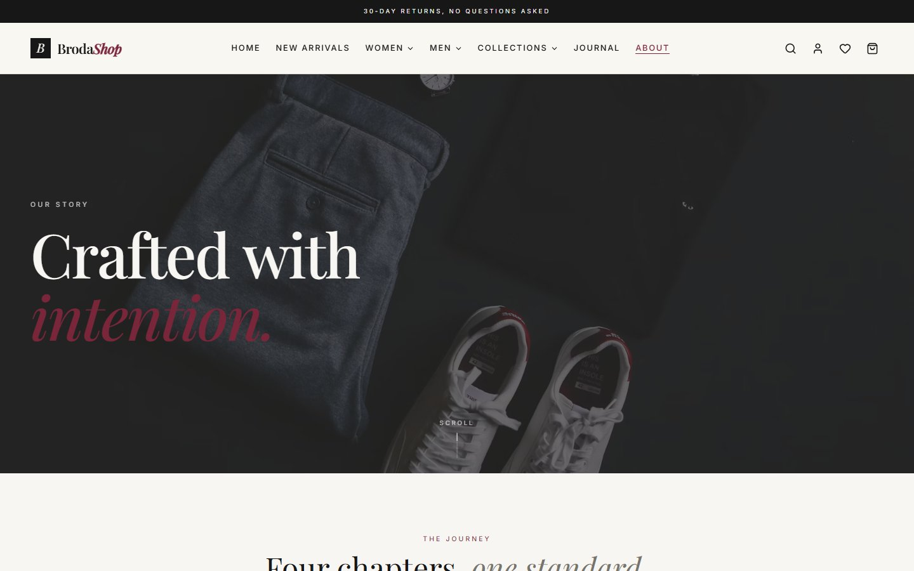 |  | 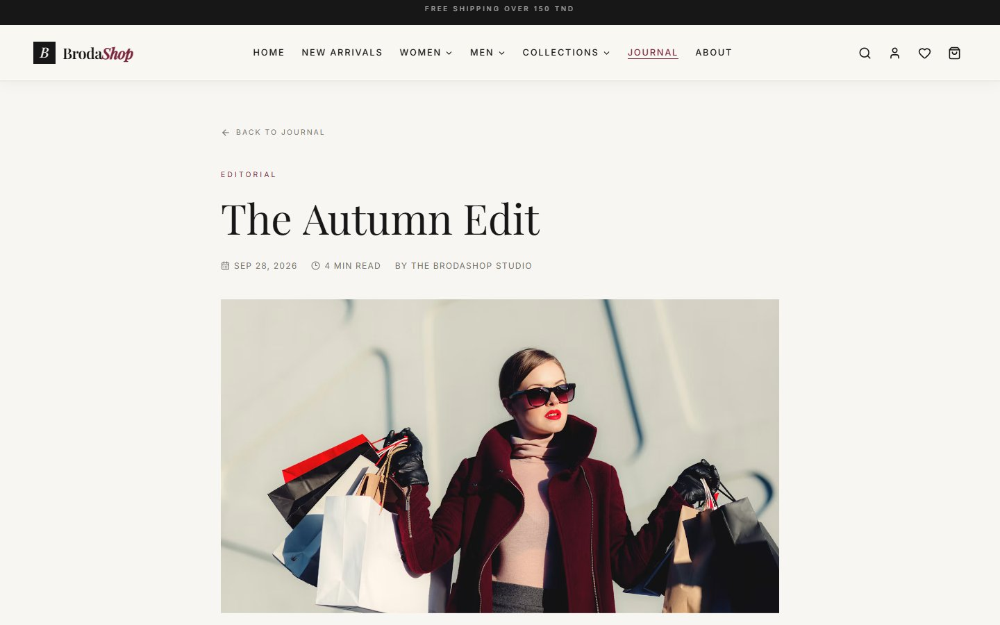 |

| Lookbook | Wishlist | Account |
|:---:|:---:|:---:|
| 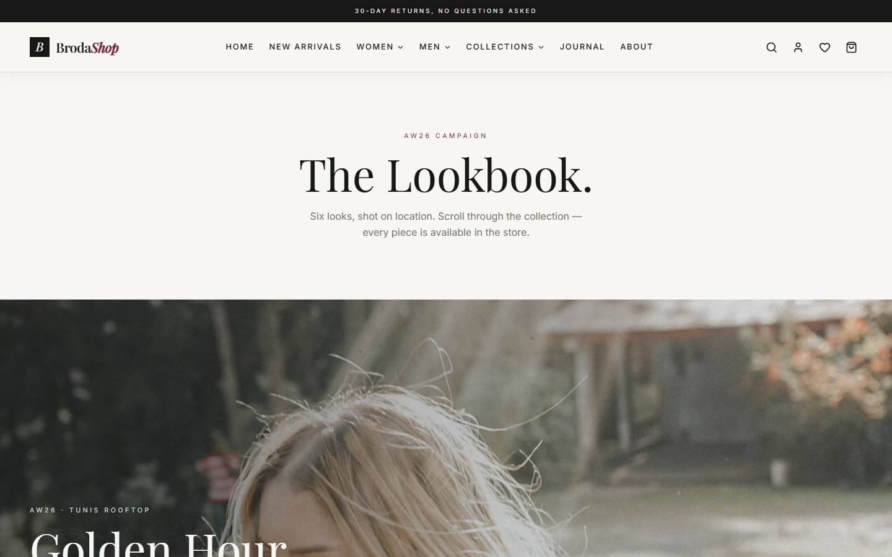 | 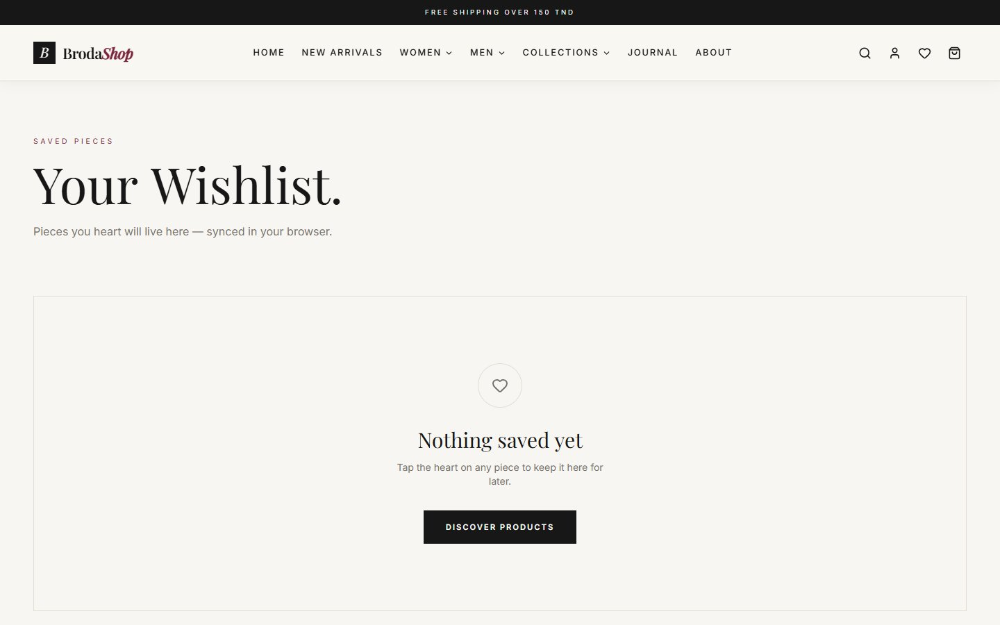 | 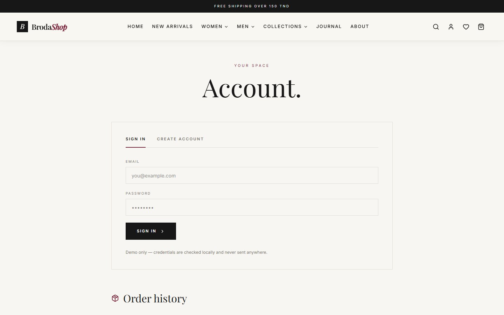 |

| Contact | Size Guide | Checkout |
|:---:|:---:|:---:|
| 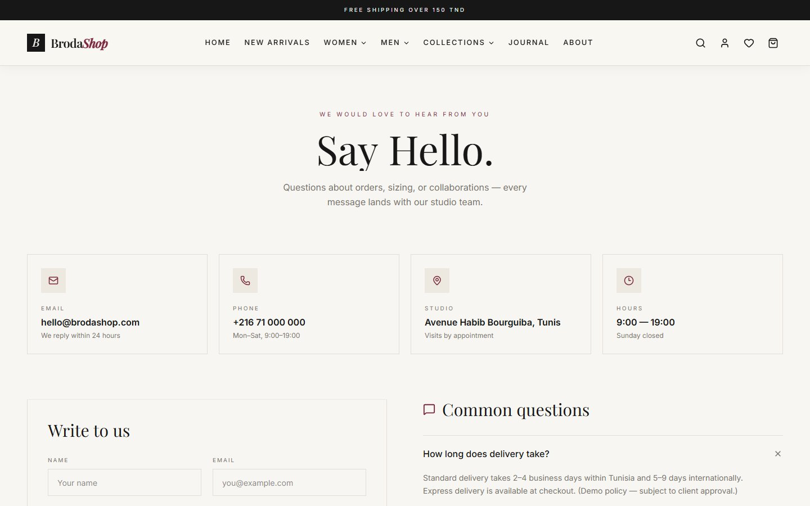 | 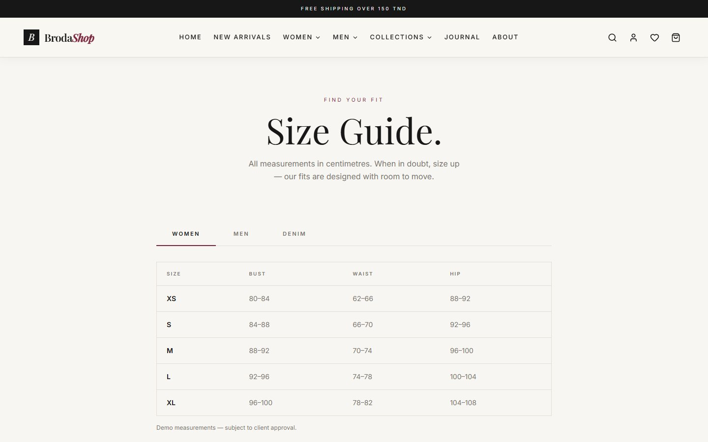 | 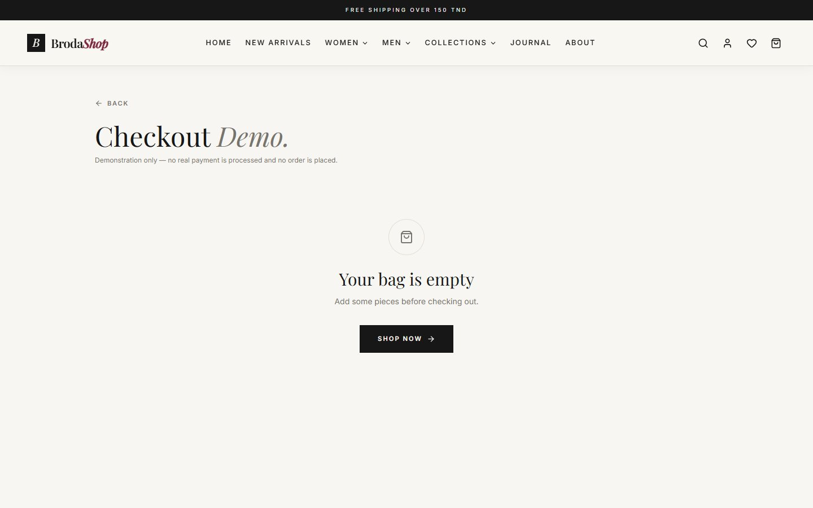 |

| 404 |
|:---:|
| 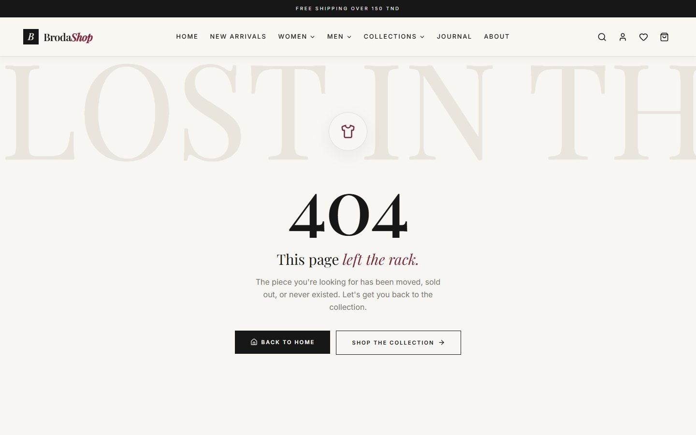 |

Regenerate them with:

```bash
npm run build
npm run preview   # serves dist on http://localhost:4173
npm run screenshots
```

## Getting Started

```bash
npm install
npm run dev      # start dev server (http://localhost:5173)
npm run build    # type-check + production build
npm run preview  # preview production build
```

## Tech Stack

- **Vite 7** + **React 19** + **TypeScript 5.9**
- **Tailwind CSS 4** (via `@tailwindcss/vite`)
- **Framer Motion 12** (animations)
- **React Router 7** (routing)
- **Lucide React** (icons)

## Demo Notes

- No real orders, payments, or sign-ins are processed — everything runs
  locally in the browser.
- Cart and wishlist persist in `localStorage`; the preloader intro is
  remembered per session (`sessionStorage`).
- Prices are shown in TND. Product data lives in `src/data/products.ts`.

## Project Structure

```
src/
├── components/   # UI components (Navbar, ProductCard, Preloader, …)
├── context/      # ShopContext (cart, wishlist, toasts, drawers)
├── data/         # Products, journal posts, lookbook, testimonials, FAQs
└── pages/        # Route pages
```
